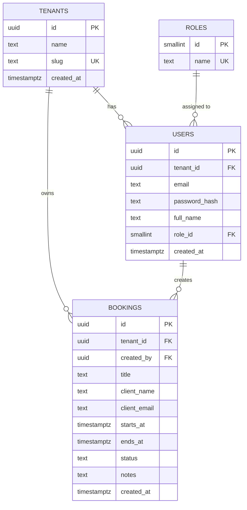
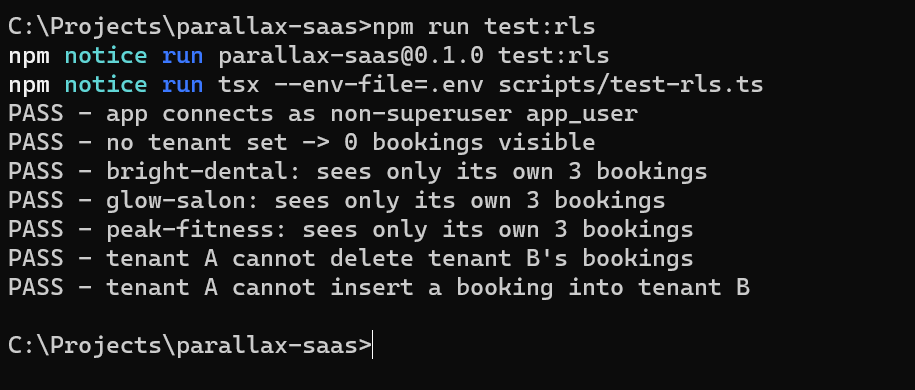

# Multi-Tenant SaaS Booking Platform

A multi-tenant B2B SaaS booking platform built for the Parallax Labs Full-Stack Developer Internship (Track B). Each organization (tenant) gets its own isolated data, enforced at the database level with PostgreSQL Row-Level Security.       

## Week 1 Status: Architecture & Multi-Tenant Schema  

- [x] Next.js (TypeScript, App Router) + Tailwind CSS project
- [x] `.env` validation with Zod
- [x] Docker Compose for PostgreSQL (plus Mailpit for local emails)
- [x] Multi-tenant schema (tenants, users, roles, bookings), migration runner and seed data
- [x] Tenant data isolation with PostgreSQL RLS, plus an automated isolation test
- [ ] Auth UI: Organization Onboarding, Login, Register, Password Reset (in progress)

## Tech Stack

Next.js, TypeScript, Tailwind CSS, Zod, PostgreSQL 16, Docker Compose, node-postgres (`pg`), bcryptjs, Mailpit

## Database Schema (ERD)



## Tenant Isolation

Isolation is enforced by the database, not by application code, so a bug in an API route cannot leak data between tenants.

- `tenants`, `users` and `bookings` all have Row-Level Security **enabled and forced**.
- Every policy compares the row's tenant to `current_tenant_id()`, which reads the `app.current_tenant` setting.
- The app connects as `app_user`, a limited role (not a superuser, no `BYPASSRLS`). Superusers and table owners bypass RLS, so this separation is essential.
- For each request, the app starts a transaction and runs `set_config('app.current_tenant', <tenant id>, true)`, which applies only to that transaction.
- If no tenant is set, the function returns NULL and **zero rows** are visible (safe by default).
- `resolve_tenant(slug)` is a small `SECURITY DEFINER` function that lets login find a tenant by its slug before a tenant is selected.

### Isolation proof

`npm run test:rls` connects as `app_user` and checks that each tenant sees only its own bookings, that no tenant means no rows, and that cross-tenant deletes and inserts are blocked.



## Getting Started

**Requirements:** Node.js 20+, Docker Desktop

```bash
git clone https://github.com/kamer-heap/Multi-tenant-SaaS-booking-platform.git
cd Multi-tenant-SaaS-booking-platform
npm install
```

Create the env file (`copy .env.example .env` on Windows, `cp .env.example .env` on macOS/Linux), then:

```bash
docker compose up -d      # PostgreSQL + Mailpit
npm run db:migrate        # create tables, roles and RLS policies
npm run db:seed           # 3 sample organizations
npm run test:rls          # verify tenant isolation
npm run dev               # http://localhost:3000
```

Mailpit (password-reset emails in development) runs at http://localhost:8025.

### Seed accounts

Password for all seed users: `Password123!`

| Organization | Slug | Example login |
|---|---|---|
| Glow Salon | `glow-salon` | `owner@glow-salon.test` |
| Bright Dental Clinic | `bright-dental` | `owner@bright-dental.test` |
| Peak Fitness Studio | `peak-fitness` | `owner@peak-fitness.test` |

Each organization also has `admin@` and `member@` users.

## Project Structure

```
db/migrations/   SQL migrations (001 schema, 002 RLS)
scripts/         migrate, seed and RLS test scripts
src/             Next.js app and Zod env validation
docker-compose.yml
```

## Approach

I used plain SQL migrations so the RLS policies are explicit and reviewable. The database enforces isolation, and an automated test proves it using the same limited role the application uses.
